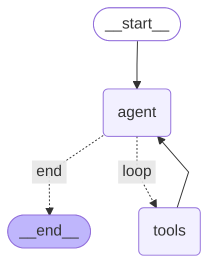

# Grafo de Execução da Lana

> Este arquivo é gerado automaticamente pelo script `scripts/desenhar_grafo.py`.
> Para regenerar, execute:
> ```bash
> docker run --rm -v "$PWD":/app -w /app -e AI_PROVIDER=GEMINI -e AI_MODEL=fake -e GEMINI_API_KEY=fake python:3.12.14-slim sh -c "pip install -q -r requirements-dev.txt && PYTHONPATH=. python scripts/desenhar_grafo.py"
> ```

## Diagrama de Estados e Transições



## Nós do Grafo

- `__start__`: Ponto de entrada da execução no LangGraph, direcionando as mensagens iniciais ao nó `agent`.
- `agent`: Nó supervisor do agente (`app/agent/supervisor.py`), responsável por invocar a LLM e decidir se chama ferramentas ou encerra o turno.
- `tools`: Nó executor (`ToolNode` em `app/agent/graph.py`), que executa `consultar_banco` ou `registrar_parametros_regra` e devolve os resultados ao estado.
- `__end__`: Ponto final do fluxo quando o nó `agent` gera uma resposta direta sem novas chamadas a ferramentas.
